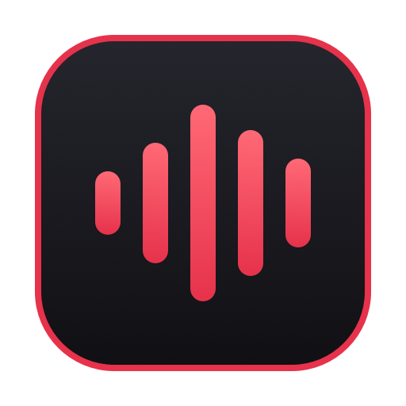

> This branch contains the experimental Monterey build. The unchanged Modern app source remains on `main`.

<p align="center">
  
</p>

<h1 align="center">Focusrite Volume Control</h1>

<p align="center">🔊 Your Mac’s volume keys. Your Focusrite.</p>

<p align="center">
  <a href="https://github.com/wc2184/focusrite-volume-control/releases/latest">Download</a> ·
  <a href="https://github.com/wc2184/focusrite-volume-control/issues">Issues</a>
</p>

A tiny macOS app that lets your Mac’s volume keys control your Focusrite’s volume. Native-style volume HUD, custom shortcuts, and a big, readable Dock volume display. Works with Focusrite Control 2 minimized.

**Heavily based on [Nick Morozov’s Focusrite Volume Control](https://github.com/enum-dot-dev/focusrite-volume-control).** I made this version because the original required macOS Sequoia or later, and I wanted to stay on Sonoma.

<p align="center">
  
</p>

<p align="center"><sub>Volume up. Volume down. Right where you expect it.</sub></p>

## Install

1. Choose the ZIP for your macOS version from [Releases](https://github.com/wc2184/focusrite-volume-control/releases/latest), unzip it, and move **Focusrite Volume Control.app** to **Applications**.
2. This release is not notarized. Before opening it, run this in Terminal to remove quarantine attributes from the downloaded app:

   ```sh
   xattr -cr "/Applications/Focusrite Volume Control.app"
   ```

3. Open the app and grant **Accessibility** access in **System Settings → Privacy & Security → Accessibility**. Allow Automation if prompted.
4. Enable **Direct Monitor** in **Focusrite Control 2**, or press the **Direct** button on your physical Focusrite interface.
5. Keep **Focusrite Control 2** running and select your Focusrite as the Mac’s sound output. Press your volume keys.

| Build | macOS | Status |
| --- | --- | --- |
| [Modern-Sonoma-and-Later](https://github.com/wc2184/focusrite-volume-control/releases/download/v1.0.1/Focusrite-Volume-Control-v1.0.1-Modern-Sonoma-and-Later.zip) | Sonoma 14.5+ | Recommended; the original binary, unchanged |
| [Ventura-Experimental](https://github.com/wc2184/focusrite-volume-control/releases/download/v1.0.1/Focusrite-Volume-Control-v1.0.1-Ventura-Experimental.zip) | Ventura 13 | Experimental |
| [Monterey-Experimental](https://github.com/wc2184/focusrite-volume-control/releases/download/v1.0.1/Focusrite-Volume-Control-v1.0.1-Monterey-Experimental.zip) | Monterey 12 | Experimental |

All builds support Apple silicon and Intel Macs and require a compatible Focusrite interface and **Focusrite Control 2**. The experimental builds have passed build and unit checks on Sonoma; they have **not been tested on Ventura or Monterey**, and older FC2 versions may have different controls. Use an FC2 version compatible with your OS and interface.

On Monterey, set up launch at login manually in **System Preferences → Users & Groups → Login Items**; the app’s automatic toggle is unavailable.

## Everyday use

- Volume and mute keys control your interface. Custom shortcuts are available in Preferences.
- The Dock shows the confirmed dB value, a mute icon at −127, or **—** when unavailable.
- Click the Dock icon to toggle Preferences; click the menu bar icon for the volume popover.

If volume keys stop working after an update, toggle the app off and on in Accessibility settings, then relaunch it.

## How it works

Like Nick’s version, the app controls Focusrite Control 2 through UI automation using AppleScript and macOS’s Accessibility API. When your Focusrite is selected as the sound output, a `CGEventTap` intercepts your volume keys and routes them to FC2’s volume controls instead of macOS’s built-in volume control.

This version builds on that approach for more reliable, consistent control. It writes directly to cached Accessibility controls first, with AppleScript as a fallback. Rapid key presses accumulate through a single volume writer, and older refresh results cannot overwrite pending changes. The HUD responds immediately, while the Dock independently reads FC2’s confirmed volume to keep its display accurate.

---

An independent project, unaffiliated with Focusrite.
